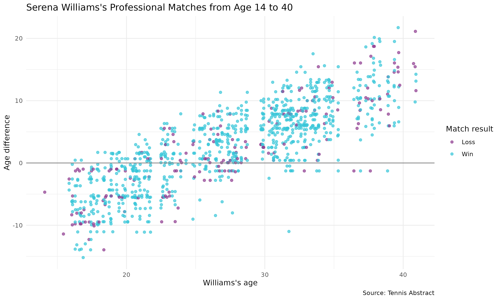

# Introduction

For this homework, I reproduced a scatter plot about Serena Williams's professional tennis matches. This assignment is a continuation of HW1, where I planned how to recreate the graph. In HW2, I used real match data from Tennis Abstract instead of the example data I used before.

# Data and Methods

I downloaded Serena Williams's career match data from Tennis Abstract. The original data was stored in a JavaScript file, so I used R to clean and organize the information.

I calculated Serena's age and her opponent's age at the time of each match. Then I calculated the age difference by subtracting the opponent's age from Serena's age. I also separated the match results into wins and losses.

After cleaning the data, I used ggplot2 in R to create the scatter plot.

# Reproduced Plot

# Results

The x-axis shows Serena Williams's age, and the y-axis shows the age difference between Serena and her opponent. Each dot represents one match. Blue dots represent wins, and purple dots represent losses.

When a point is above zero, Serena was older than her opponent. When a point is below zero, she was younger.

From the graph, I noticed that when Serena was younger, she mostly played against older opponents. As she got older, she played against more younger opponents. I also noticed that she won many matches throughout her career.

# Conclusion

Through this assignment, I learned how to download raw data, clean it in R, and use the cleaned data to reproduce a graph. I also learned why it is important to organize files and keep the raw data separate from the cleaned data so that other people can reproduce the same results.

# Data Source

Tennis Abstract: https://www.tennisabstract.com/cgi-bin/wplayer-classic.cgi?p=SerenaWilliams&f=ACareerqq